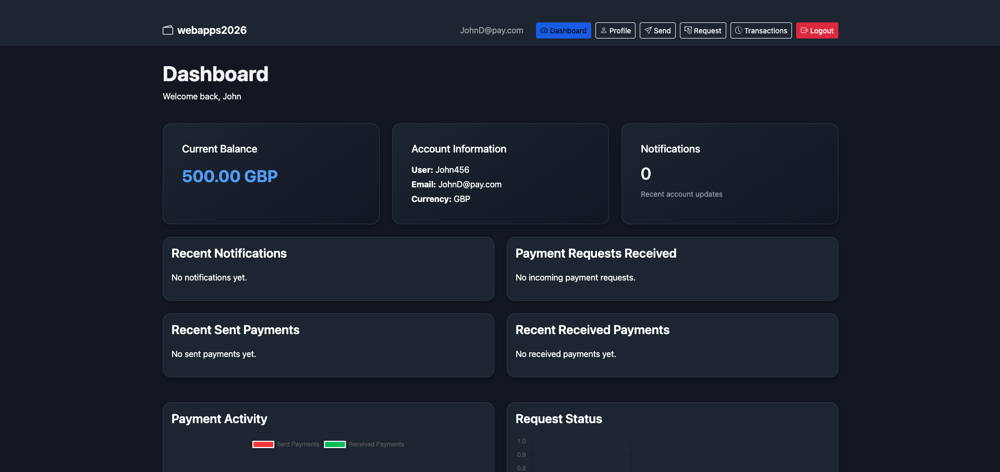
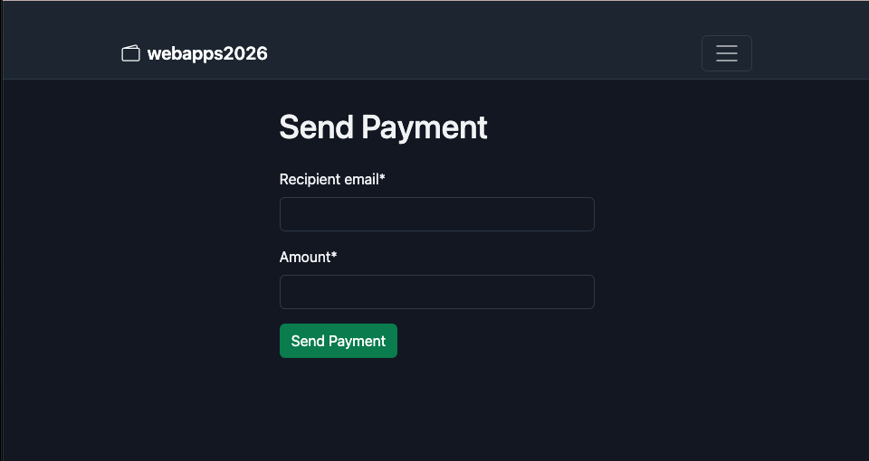
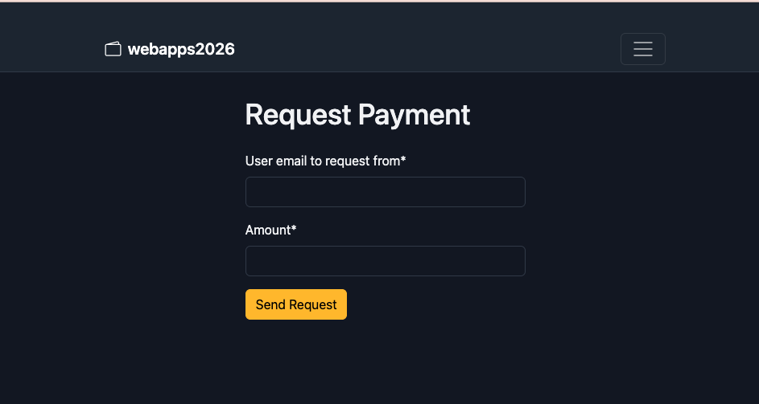
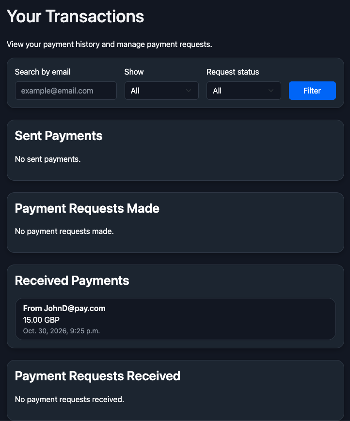
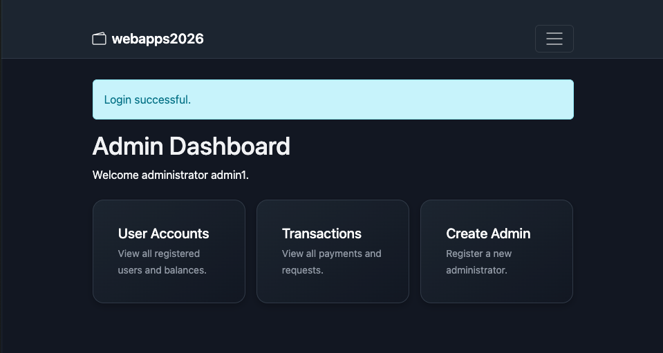

# Online Payment Service

A Django-based web application demonstrating account management, peer-to-peer payments, payment requests, transaction tracking and administrator functionality, supported by a PostgreSQL database.

Developed as part of the **Web Applications and Services** module at the University of Sussex, and subsequently extended with Docker and PostgreSQL.

## Overview

The Online Payment Service is an educational project designed to demonstrate how a web application can manage users, account balances and transactions.

The application uses Django for backend logic and authentication, PostgreSQL for persistent data storage, and Bootstrap for its responsive interface. Docker Compose runs the Django application and PostgreSQL database as separate, connected containers.

**Note:** This is a demonstration using application-managed balances, not a production payment platform or an integration with real banking services.

## Features

### User functionality

- User registration and authentication
- Account dashboard displaying balances and notifications
- Send payments to other registered users
- Request payments from other users
- View sent and received transactions
- Filter transaction history
- View account information and payment activity

### Administrator functionality

- Administrator dashboard
- View registered accounts and balances
- View transactions and payment requests
- Create administrator accounts
- Account management functionality

### Currency conversion API

- HTTP GET endpoint supporting GBP, USD and EUR
- Calculations using Python's `Decimal` type
- JSON responses
- Validation of currency codes and amounts
- Error responses for invalid requests

**Exchange rates are predefined for demonstration purposes, not live market rates.**

## Application Screenshots

### User Dashboard



### Send Payment



### Request Payment



### Transaction History



### Administrator Dashboard



## Technology Stack

| Component | Technology |
|---|---|
| Backend | Python 3.12, Django 6.0.4 |
| Database | PostgreSQL 16 |
| Frontend | HTML, CSS, JavaScript, Bootstrap 5 |
| Database integration | Django ORM, psycopg2 |
| Forms | django-crispy-forms |
| Configuration | python-decouple |
| Containerisation | Docker, Docker Compose |
| API responses | Django JsonResponse |

## Project Structure

```text
webapps2026/
├── conversionapi/       # Currency conversion API
├── payapp/              # Payment and account functionality
├── register/            # Registration and authentication
├── templates/           # Django HTML templates
├── webapps2026/         # Django project configuration
├── screenshots/         # Application screenshots
├── manage.py
├── requirements.txt
├── Dockerfile
├── docker-compose.yml
├── .env.example
└── README.md
```

## Running the Application with Docker

### Prerequisites

- Git
- Docker Desktop (or Docker Engine with Docker Compose)

### 1. Clone the repository

```bash
git clone https://github.com/PNT927/online-payment-service.git
cd online-payment-service
```

### 2. Configure environment variables

Copy the example configuration:

```bash
cp .env.example .env
```

Open `.env` and replace `replace_with_your_development_password` with a password of your choice. Keep `.env` private: it is excluded from Git. The Django service connects to the database using the Compose service hostname `db`.

**Existing local installations:** If you already have a PostgreSQL Docker volume, keep the original database password in `.env`; changing the environment variable alone does not change the password of an existing database user.

### 3. Build and start the containers

```bash
docker compose up --build -d
```

### 4. Apply database migrations

```bash
docker compose exec web python manage.py migrate
```

### 5. Open the application

Visit [http://127.0.0.1:8000/](http://127.0.0.1:8000/) and register an account to explore the application.

The application uses port `8000`. The Docker Compose configuration also exposes PostgreSQL on host port `5433` for local development.

### 6. Stop the containers

```bash
docker compose down
```

Database data is retained in a Docker named volume. **Do not use `docker compose down -v` if you want to preserve that data.**

## Currency Conversion API

**Method:** `GET`

**Endpoint:**

```text
/webapps2026/conversion/<source>/<destination>/<amount>/
```

**Example request:**

```text
http://127.0.0.1:8000/webapps2026/conversion/GBP/USD/100/
```

**Example JSON response:**

```json
{
  "from_currency": "GBP",
  "to_currency": "USD",
  "rate": "1.25",
  "converted_amount": "125.00"
}
```

The endpoint supports GBP, USD and EUR and returns HTTP 400 for invalid amounts or unsupported currencies and HTTP 405 for methods other than GET. The exchange rates are fixed demonstration values.

## Security Considerations

The application uses Django's built-in authentication, password hashing, CSRF protection and ORM-based database access. Local environment configuration and private keys should not be committed to version control.

This project runs Django's development server and is intended for local demonstration. It has not been security-audited or configured for production financial transactions.

## Limitations and Future Improvements

- Replace predefined exchange rates with a maintained exchange-rate data source
- Expand automated testing for payments, authentication and permissions
- Improve error handling and validation
- Introduce production-ready deployment configuration
- Strengthen secret management and environment separation
- Expand transaction reporting and account analytics

## Author

**Philip Tagoe Jr**  

